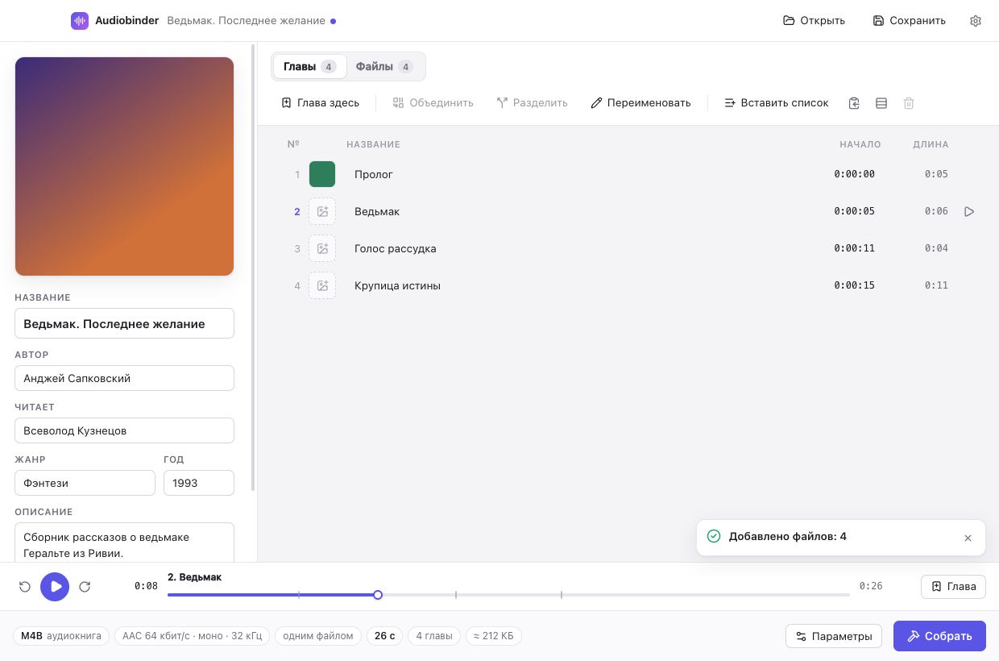

# Audiobinder

Сборщик аудиокниг для macOS и Windows — современная замена Audiobook Builder.
Склеивает любые аудиофайлы в M4B, заполняет метаданные, расставляет главы
(по файлам или по таймкодам), добавляет обложку и картинки глав.



## Возможности

- **Любые исходники**: MP3, M4A/M4B, FLAC, WAV, OGG/Opus, AAC, AIFF, WMA и всё,
  что читает ffmpeg. Файлы и папки перетаскиваются в окно, сортировка «как в
  Finder» (2 раньше 10).
- **Без ограничений по длине**: книга одним файлом хоть на 100+ часов. Длинные
  книги пишутся с 64-битными атомами MP4 (проверено на 40 ч и 4,6 ГБ — Apple
  читает длительность и главы правильно).
- **Метаданные**: название, автор, чтец, жанр, год, описание (полностью — в
  `ldes`), издатель, копирайт, комментарий, текст (Lyrics), кодировщик, обложка.
  Можно выбрать, в какие теги писать автора и чтеца (Artist / Album Artist /
  Composer); чтец всегда дублируется в тег Narrator (`©nrt`).
- **Главы**:
  - по одной на файл, по встроенным главам файла или где угодно внутри файла;
  - «Глава здесь» — отметка в текущей позиции плеера (⌘M);
  - вставка списка таймкодов («0:00 Пролог», YouTube/Audible-стиль, OGM);
  - объединение, разделение по файлам, правка времени начала прямо в таблице;
  - переименование по шаблону (`Глава {n}: {name}`, нумерация, ведущие нули);
  - картинка для каждой главы (QuickTime chapter images — видны в Apple Books и
    «Музыке»), главы без картинки показывают обложку.
- **Сборка**: M4B (аудиокнига, с закладками) или M4A; AAC или HE-AAC (на macOS —
  кодек Apple); пресеты качества и свои параметры; **склейка без перекодирования**,
  если исходники — совместимый AAC.
- **Деление на части** (по желанию): примерно по N часов с разрывом между главами
  или файлами, ровно по N часов, или файл на каждую главу. Разорванная глава
  продолжается в следующей части («… (продолжение)»).
- **Редактирование готовых книг**: открыть M4B → поправить главы/теги/обложку →
  пересобрать (картинки глав тоже извлекаются).
- **Проекты** `.abproj` — лёгкий JSON со ссылками на файлы: сохранить и вернуться
  позже, перенос папки вместе с проектом не ломает пути.
- Отмена/повтор, предпрослушивание с переходом между файлами, светлая и тёмная
  тема, прогресс с оценкой времени и отменой.

Чего нет по сравнению с Audiobook Builder: импорта с аудио-CD и из медиатеки
Music/iTunes (файлы просто перетаскиваются из Finder/Проводника).

## Установка

**macOS (Apple Silicon)** — `Audiobinder-<версия>-mac-arm64.dmg` или `.zip`.
Приложение подписано ad-hoc (без сертификата Apple), поэтому после копирования
в «Программы» один раз снимите карантин:

```bash
xattr -dr com.apple.quarantine /Applications/Audiobinder.app
```

**Windows (x64)** — установщик `…-win-x64-setup.exe` или переносная версия
`…-win-x64-portable.exe`. SmartScreen может предупредить о неизвестном
издателе: «Подробнее» → «Выполнить в любом случае».

ffmpeg уже внутри приложения, ставить его отдельно не нужно.

## Сборка из исходников

Нужны Node.js 22+ и npm.

```bash
npm install
npm run fetch:ffmpeg      # статические ffmpeg/ffprobe → vendor/ffmpeg/{mac-arm64,win-x64}
npm run dist:mac          # dist/*.dmg, dist/*.zip
npm run dist:win          # dist/*-setup.exe, dist/*-portable.exe (собирается и на macOS)
```

Разработка: `npm run dev` (без `vendor/` используется системный ffmpeg из PATH
или Homebrew). Иконка перерисовывается из `resources/icon.svg`: `npm run icon`.

### Проверки

```bash
npm test                  # ядро: главы, планирование, сборка реальных файлов через ffmpeg
npm run typecheck
SMOKE_DIR=/путь/к/папке/с/mp3 npm run smoke   # невидимый прогон UI со скриншотами
swiftc -O tools/avcheck.swift -o build/avcheck && build/avcheck книга.m4b   # что видит Apple
```

## Как устроено

```
src/core/      чистый Node (без Electron), запускается тестами напрямую
  probe.ts       ffprobe: длительность, формат, теги, встроенные главы
  chapters.ts    главы привязаны к файлу и смещению — переживают перестановку файлов
  plan.ts        части, проверка pass-through, раскладка тегов, имена файлов
  build.ts       декодирование каждого файла в PCM → один AAC-энкодер (точный подсчёт
                 сэмплов, поэтому главы не «уплывают»), либо concat без перекодирования;
                 затем ffmpeg пишет трек глав
  mp4.ts         свой редактор атомов MP4: теги iTunes, обложка, трек картинок глав,
                 64-битные смещения; меняет только хвост файла — аудио не копируется
  importer.ts    разбор готовой M4B/MP3 обратно в проект
src/main/      Electron: окно, меню, IPC, протокол media:// для предпрослушивания
src/preload/   мост window.api (contextIsolation + sandbox)
src/renderer/  интерфейс на React + zustand
```

## Лицензии

Код Audiobinder — MIT. В дистрибутивы входит [FFmpeg](https://ffmpeg.org):
для Windows — LGPL-сборка [BtbN](https://github.com/BtbN/FFmpeg-Builds), для
macOS — сборка [Martin Riedl](https://ffmpeg.martin-riedl.de); исходники и
условия — на сайтах проектов.
